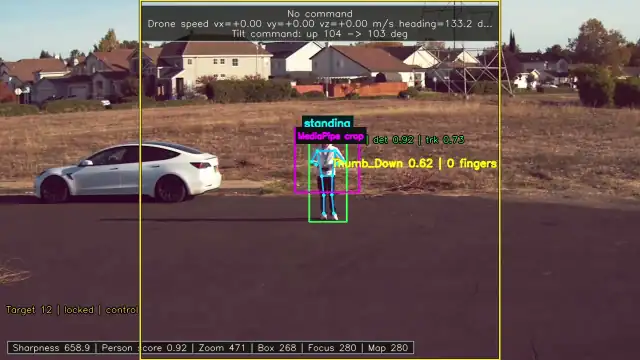
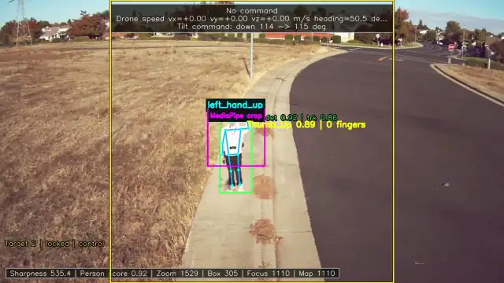
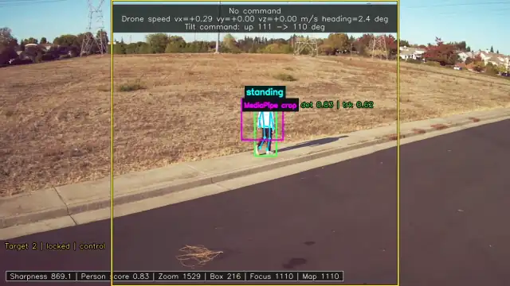
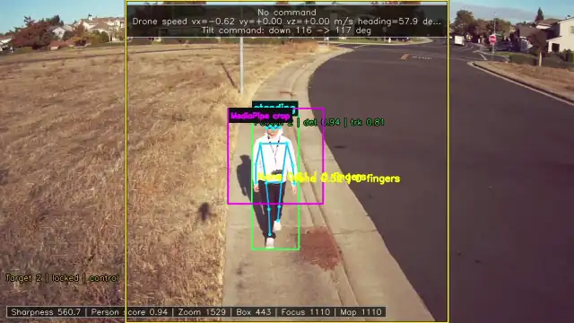
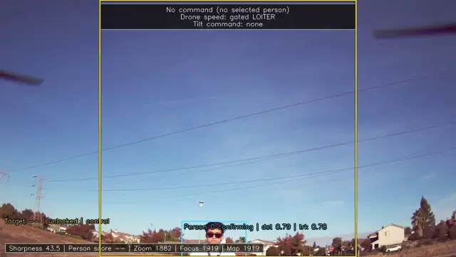
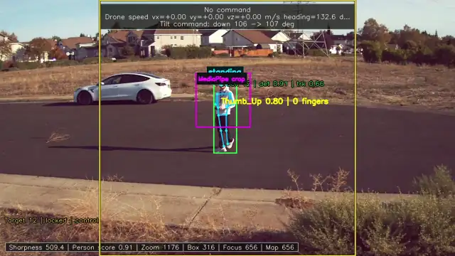

# Gesture-controlled camera drone on a Jetson Orin Nano

I'm building a drone that flies by hand gesture, locks onto its pilot, and keeps them framed with its pan-tilt-zoom camera. Detection, tracking, gesture recognition, camera control and flight commands all run on board, on a Jetson Orin Nano connected to a Pixhawk 6C flight controller running ArduCopter.

I wrote the software and fly the test flights. The application repository is private; this repository holds the write-ups, measurements and clips. Since May 2026 the application has grown to 254 commits and about 1,400 automated tests.

https://github.com/user-attachments/assets/c954f707-9052-458e-8af9-3767928d823a

## What it does

All clips are from flights on 2026-10-28, with the stream's overlays: the top banner shows the current command and the speed sent to the drone, and the bottom-left label shows the person lock.

<table>
<tr>
<td width="50%"><br><b>Gesture flight.</b> Both hands up: Move forward at 1 m/s, and the drone flies toward the pilot.</td>
<td width="50%"><br><b>Up and down.</b> Left hand up moves the drone down, right hand up moves it up. Its shadow is on the sidewalk.</td>
</tr>
<tr>
<td width="50%"><br><b>Follow mode.</b> The pilot walks away; the drone keeps its distance and turns to keep them centred.</td>
<td width="50%"><br><b>Person lock and pose.</b> The lock and the 17-point skeleton stay on the pilot as they walk toward the drone, which backs away.</td>
</tr>
<tr>
<td width="50%"><br><b>Auto tilt.</b> On takeoff the camera starts on the sky, finds the pilot and tilts to keep them centred.</td>
<td width="50%"><br><b>Auto zoom.</b> The lens zooms in (raw zoom 1176 to about 470; lower is closer) and the focus map keeps the pilot sharp.</td>
</tr>
</table>

- **Locks onto the pilot.** It picks a person whose whole body is in view and whose eyes are both visible, then stays on that person's tracker ID. Every update is checked against the person's appearance (ReID embeddings), so the lock stays on the pilot instead of jumping to someone else.
- **Takes gestures as flight commands.** Two closed fists enter Movement mode. Hand and arm gestures then move the drone forward, back, left, right, up and down; two open palms or crossed arms stop it. Only the locked person's gestures count, and a move only starts while both of their eyes are visible, so a person facing away can't start one.
- **Follow mode.** Two thumbs up start follow mode. The drone flies forward or backward to keep the pilot at the distance they were when it started, while auto yaw turns to keep them centred.
- **Keeps the pilot framed.** The tilt servo keeps the pilot vertically centred and turns against the drone's pitch like a gimbal. Auto zoom keeps the pilot at a set size in the frame, and a measured zoom-to-focus map keeps the image sharp.
- **Voice commands (optional).** Spoken or typed commands go to a local Qwen model running under `llama.cpp` on the GPU, which turns them into the same commands as gestures. Piper speaks the replies.
- **Browser control.** A web page shows the live annotated stream, switches stream profiles, and plays back recordings with the overlays.

**Safety.** Gesture and voice commands go through one command router. Movement is only sent while a recent Pixhawk heartbeat reports GUIDED mode and the drone is armed; switching the flight mode on the radio ends gesture control at once. Motion output can also be switched off with a stream profile.

## How it works

```text
Arducam 12 MP pan-tilt-zoom camera (CSI)
  -> Argus / GStreamer -> DeepStream
       YOLO26s-pose, TensorRT FP16: people + 17 body keypoints in one pass
       NvDCF tracker + ReID embeddings: persistent IDs
  -> person lock -> gestures: body pose + MediaPipe hands (separate process)
  -> command router  <- voice: local Qwen (separate process)
  -> MAVLink, GUIDED only -> Pixhawk 6C / ArduCopter 4.6
  -> camera controller over I2C: tilt, zoom, focus
  -> browser MJPEG stream, recordings with overlays
```

Work that can block or crash runs in its own process: MediaPipe, recording, the voice model and speech. A supervisor restarts the video process if frames stop arriving. The pipeline holds the camera's 30 FPS in flight.

| Part | What it is |
| --- | --- |
| Computer | NVIDIA Jetson Orin Nano developer kit (8 GB) |
| Flight controller | Pixhawk 6C, ArduCopter 4.6.3 |
| Camera | Arducam 12MP 477P pan-tilt-zoom camera over CSI; tilt servo, zoom and focus motors share one I2C controller |
| Software | Python, DeepStream 7.1, TensorRT, GStreamer, NvDCF tracker, MediaPipe, MAVLink (pymavlink), `llama.cpp`, Piper |


## Engineering highlights

Each of these started from a flight recording or a measurement, and most were checked in simulation or on the bench before flying.

### Keeping the camera on the pilot

- **Tilt that lagged, then hunted.** The image showed a tilt move a quarter to half a second after it was sent, so a faster controller kept correcting an error it had already fixed and swung back and forth. I measured the loop delay from per-frame timestamps and tilt writes, built a closed-loop simulation around the real controller, and added a Smith predictor: each frame, the controller subtracts the tilt it has commanded but the image can't show yet. That let the tilt run twice as fast without hunting; in four flights the pilot was more than 0.15 of the frame off centre in 1.3–3.4% of frames, against 5.3% before. [Camera tilt loop note](notes/camera-tilt-loop.md)
- **A camera controller that drops commands.** In one recording the camera reacted late to a fast backward move. I wrote a bench probe and found the camera's I2C controller ignores tilt writes while the zoom or focus motor is moving. The tilt now gets the controller between zoom steps, and zoom holds while the drone pitches fast. (Built and bench-tested; not flown yet.)
- **The right person, every frame.** I compared the lock's colour histogram with ReID embeddings on the MOT17 tracking dataset's ground truth: ReID picked the right person 96% of the time against 72%, so the lock now uses ReID. When a 0.1 s lock dropout cancelled Movement mode in flight, I traced it to the tracker keeping the pilot's ID on a weaker duplicate box, below the detector's score floor, and gave the locked ID its own lower floor.

### Flying from what the camera sees

- **Follow mode that kept up.** The first follow controller reacted late and moved at one fixed speed, so a walking pilot got up to twice as far away. From the recording and the Pixhawk log I measured how the drone responds to speed commands (0.2 s delay, 0.4 s lag), put that into a follow simulation, and replaced it with a proportional controller with a speed ramp. The flights after that showed backing away is still limited by how fast it reacts, not by the ramp, so the next step is feed-forward from the pilot's own speed.
- **Turning toward the pilot.** Turn-rate commands showed up in the image 0.6–0.8 s later, so auto yaw overshot. Auto yaw now aims at an absolute heading, worked out from the drone's heading at the moment the frame was captured, so a late frame doesn't add more turn.
- **Tuning the airframe.** I ran ArduPilot AutoTune on yaw, roll and pitch, and wrote tools to download Pixhawk logs over MAVLink (refused while armed) and review flights for vibration, battery and control response. When the drone turned 60 degrees by itself in one flight, the log showed the heading estimate had moved against the gyros after a takeoff on a magnetically disturbed spot.

### Making it fast and reliable

- **One model pass instead of two.** The stream found people with a segmentation model, then ran a pose model on each person. The pose model already outputs each person's box, so I made it the only detector: **38.6 → 58.7 FPS** on a fixed replay clip, with the same people found and the lock held as well. In later flights, a frame reached the tilt decision in 35–43 ms instead of 202 ms. [Note](notes/pose-model-person-detector.md)
- **From 8.5 to 30 FPS.** Moving YOLO inference from the CPU to a TensorRT FP16 engine took the first camera stream from 8.5 to the camera's 30 FPS limit. Later work moved detection into DeepStream and cut per-frame CPU work with Nsight Systems: RGB frames end to end, shared memory instead of JPEG for the hand worker, and one direct GPU-to-NumPy copy (callback p95 19.1 → 13.4 ms).
- **A crash that wasn't the model.** The video pipeline crashed at random. I matched DeepStream buffer-copy failures to kernel GPU memory faults and CUDA error 700, ruled out the TensorRT engines by rebuilding them, and stopped it by moving the affected copies to the Jetson's VIC hardware (`copy-hw=2`) on that JetPack release.
- **Keeping the language model out of the video path.** Loading Qwen inside the DeepStream process destabilized it, so it runs as a separate warm service. GPU offload cut one command's response from 14.3 s to 4.5 s.

The [performance page](notes/performance.md) has the full measurements, Nsight timelines and method for each change.

## How I work

- **Measure before changing.** The stream logs a timestamp for every frame at each pipeline stage, every tilt write, and the drone's attitude at 25 Hz, so a recording can be lined up with the Pixhawk log to within a frame or two.
- **Simulate the control loops.** The tilt, yaw and follow simulations import the controllers that run on the drone and drive them against models measured on the bench and in flight. They rank settings before a flight; they don't replace one.
- **Bench-test the hardware.** Servo calibration (0.69 degrees of view per servo degree, 0.11 s delay), focus maps across the zoom range, and probes of the camera controller's timing.
- **Compare on a fixed input.** Pipeline changes are compared on the same replay clip, identified by its SHA-256 hash.
- **Write it up honestly.** Each [note](notes/) follows a template: question, baseline, one change, a primary metric, correctness checks, and whether the comparison is controlled or only observational, with its limits.

## Status

| Working in flight | Built, not flown yet | Next |
| --- | --- | --- |
| Person lock with ReID, gesture commands, Movement mode, follow mode, auto tilt with the Smith predictor, 30 FPS pipeline | Tilt priority between zoom steps, zoom hold during fast pitch | Follow feed-forward from the pilot's speed, two-person lock tests in flight, longer-range tests |

## Notes

- [Performance engineering](notes/performance.md): all measured results, with Nsight timelines
- [Camera tilt loop](notes/camera-tilt-loop.md) and [pose model as the person detector](notes/pose-model-person-detector.md)
- [RGB and shared memory](notes/rgb-shared-memory-comparison.md), [direct-to-NumPy copy](notes/direct-numpy-copy-comparison.md), [TensorRT level 3 versus 5](notes/tensorrt-builder-comparison.md)
- [Case studies](notes/case-studies.md), the [May field log](notes/field-log.md) and the [later stream log](notes/recent-stream-log.md)

Measurements come from one device and are often single runs; each note gives its limits. Commands in the logs show the configuration at the time and may not match the current application. Model weights, TensorRT plans, raw recordings and device configuration are not in this repository, and local account paths and LAN addresses in the logs were replaced with documentation examples.
